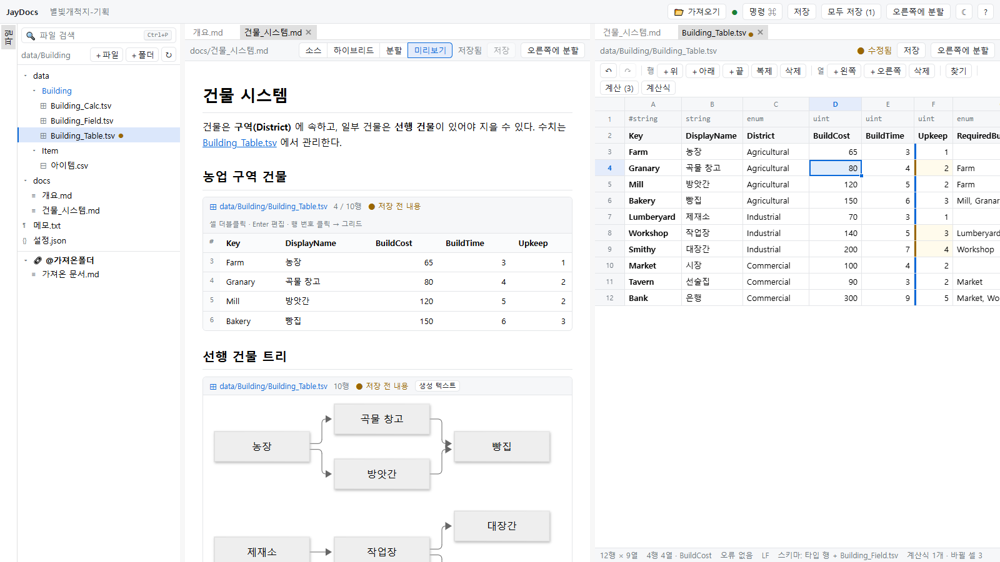
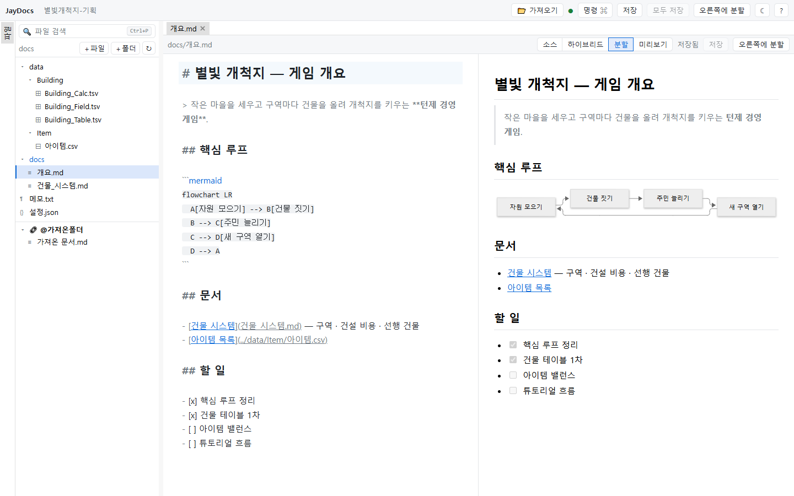
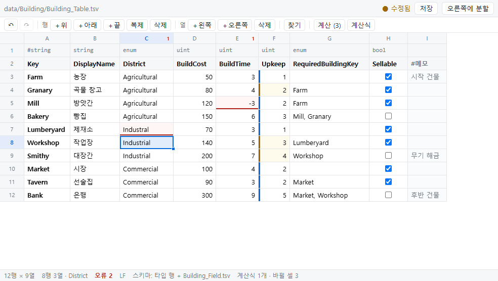
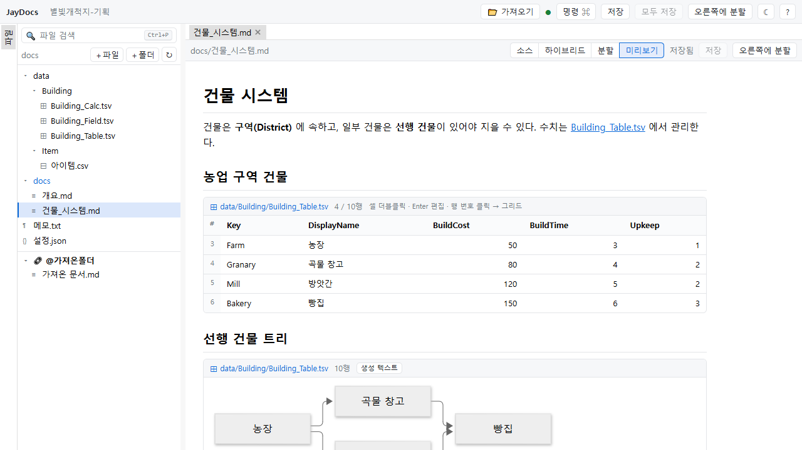
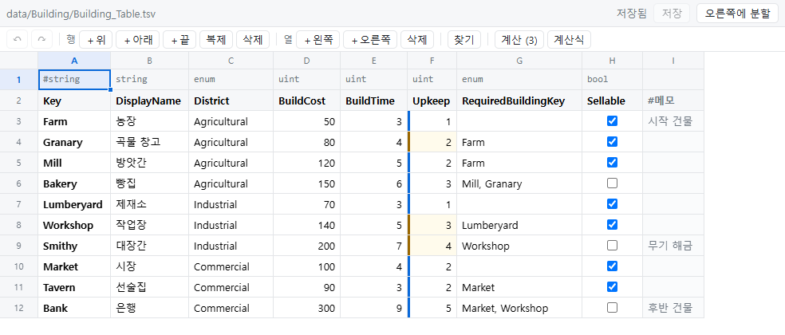
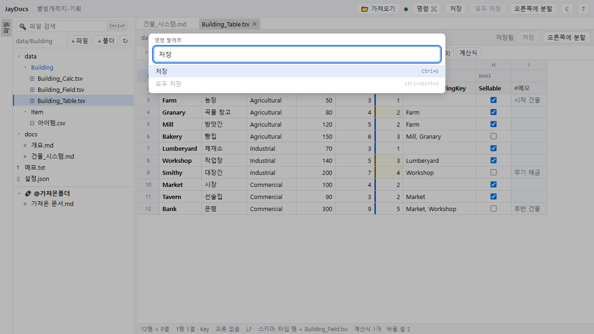

# JayDocs

**기획 문서(Markdown)와 데이터 테이블(TSV · CSV)을 한 화면에서 같이 쓰는 문서 편집기**예요.

👉 **바로 써 보기: https://krkoohoo.github.io/JayDocs/** (Windows · Edge 권장, 설치 · 가입 없음)



게임 기획을 하다 보면 설명은 노션이나 md 파일에, 수치는 엑셀이나 시트에 따로 두게 됩니다. 문서와 표가 갈라지면 "문서에 적힌 값"과 "테이블의 실제 값"이 금방 어긋나고, git 으로 관리하면 엑셀 파일은 diff 도 안 보이죠. JayDocs 는 그 둘을 한 폴더, 한 화면에 모으려고 만들었어요.

- **설치 없이 브라우저에서** 열고, 원하면 앱처럼 설치해서 씁니다.
- **내 PC 의 폴더를 직접 열어** 그 안의 파일을 바로 읽고 저장합니다. 따로 가져오기 · 내보내기가 없어요.
- **서버가 없어요.** 문서는 어디에도 올라가지 않고, 인터넷이 끊겨도 돌아갑니다.
- **git 친화적이에요.** 표에서 한 칸을 고치면 파일에서도 그 한 줄만 바뀝니다.

### 이런 분께 맞아요

- 기획서는 md 로, 데이터 테이블은 TSV · CSV 로 관리하는 게임 기획자
- 문서 폴더를 git(GitHub Desktop 등)으로 관리하는데, 표를 엑셀로 열었다 저장하면 파일이 통째로 바뀌어 곤란했던 분
- 노션 · 옵시디언처럼 md 를 보면서 쓰고 싶지만, 표 편집은 스프레드시트처럼 하고 싶은 분

## 3분 만에 시작하기

1. **Edge** 에서 https://krkoohoo.github.io/JayDocs/ 를 열고, 위쪽의 **앱으로 설치** 를 눌러요. (Chrome 도 됩니다. Firefox · Safari · 모바일은 안 돼요.)
2. **문서 폴더 열기** 로 폴더를 고르고 **허용** 을 눌러요. 별칭과 경로 입력은 건너뛰어도 돼요.
3. 왼쪽 트리에서 `.md` 나 `.tsv` 를 눌러 열고, `Ctrl+S` 로 저장해요.

> ⚠️ **처음엔 복사본이나 git 으로 관리하는 폴더로 써 보세요.** JayDocs 는 진짜 파일을 바로 고치고, 앱에서 지운 파일은 휴지통으로 가지 않아요.
>
> 💡 **브라우저 탭보다 설치한 앱으로 쓰는 걸 권해요.** 탭으로 쓰면 창을 닫을 때마다 폴더 권한을 다시 물을 수 있어요.

그림과 함께 차근차근 보려면 👉 **[시작하기 가이드](docs/guide/getting-started.md)**

## 주요 기능

### 📝 마크다운 편집 — [가이드](docs/guide/markdown.md)

**소스 / 하이브리드 / 분할 / 미리보기** 4가지 보기 모드. 하이브리드는 옵시디언처럼 커서가 있는 줄만 원문으로 보이고 나머지는 꾸며진 모습으로 보여요. Mermaid 다이어그램, 표, 체크박스, 그림이 그 자리에서 그려지고, 마크다운 표는 칸을 눌러 바로 고쳐요.



### 📊 스프레드시트 같은 표 편집 — [가이드](docs/guide/table.md)

TSV · CSV 를 엑셀 · 구글 시트처럼 편집해요 — 방향키 이동, 범위 선택, **시트 ↔ JayDocs 복사 · 붙여넣기**, 채우기 핸들, 찾기 · 바꾸기, 행 · 열 삽입 · 삭제 · 옮기기, 되돌리기. **한글 입력도 안 깨져요.**

첫 줄에 `#string enum int bool …` 같은 타입을 적어 두면 **값을 검사**해 주고, enum 칸은 후보 목록을 띄워 줘요.



표의 머리글로 **C# DTO 클래스**를 만들 수도 있어요(`Ctrl+Alt+E`). 머리글 이름이 그대로 필드 이름이 되고, 정수 열은 `int`, 실수 열은 `float`, 나머지는 `string` 이에요.

### 🔗 문서 안에 표 넣기 (`tsv-view`) — [가이드](docs/guide/tsv-view.md)

기획서에 테이블을 **복사해 붙이지 않고 연결**해요. 열 · 조건 · 정렬을 골라 보여 주고, 표 값이 바뀌면 문서 속 표도 같이 바뀌어요. 문서 안에서 값을 바로 고칠 수도 있고, 표의 행으로 **Mermaid 다이어그램을 자동으로** 그릴 수도 있어요.

````markdown
```tsv-view
file: data/Building/Building_Table.tsv
columns: [Key, DisplayName, BuildCost, BuildTime]
where: District == "Agricultural"
sort: BuildCost
```
````



### 🧮 계산식 — [가이드](docs/guide/calc.md)

`X_Table.tsv` 옆에 `X_Calc.tsv` 를 두면 `=max(1, round(BuildCost / 60))` 같은 식으로 열을 채워요. **파일에는 식이 아니라 결과 값만 남아서** 게임 쪽에서 읽을 때 신경 쓸 게 없어요. 식과 값이 어긋난 칸은 노랗게 표시되고, `F9` 한 번으로 다시 계산해요.



### 🗂️ 작업 환경 — [가이드](docs/guide/workspace.md)

- **탭 · 화면 분할** — 탭을 끌어서 나누고, 같은 문서를 두 창에 열면 한쪽에서 고친 내용이 다른 쪽에 바로 보여요.
- **다른 폴더 같이 열기** — 수업 자료, Unity 프로젝트 문서 같은 다른 폴더를 복사 없이 원래 자리에서 같이 열어요. 보기만 할 폴더는 읽기 전용으로.
- **바깥에서 바뀐 파일 감지** — 엑셀이나 `git pull` 로 파일이 바뀌면 알아서 다시 읽고, 고치던 중이면 어느 쪽을 남길지 물어요.
- **훑어보기** — 트리에서 `Space` 를 누르면 파일을 열지 않고 내용을 크게 봐요. 폴더에서 누르면 안의 문서가 썸네일로 떠요. 글을 쓸 때는 `Ctrl+Alt+M` 으로 오른쪽에 문서 전체를 축소해 띄우고, 누른 자리로 바로 가요.
- **새 문서 템플릿** — `Ctrl+Alt+N` 으로 빈 문서나 예시를 미리 보고 골라 만들어요. 주 폴더의 `_templates/` 에 넣은 파일도 템플릿으로 떠요.
- **키보드로 전부** — `Ctrl+Shift+P` 명령 팔레트, `Ctrl+P` 파일 검색, `F1` 단축키 목록.
- **다크 모드** (`Ctrl+Alt+D`), 최근 폴더 목록, `.txt` · `.json` 편집, 옛 한글 인코딩(CP949) 파일 열기, 자동 업데이트.



## 사용 가이드

| | 가이드 | 내용 |
|---|---|---|
| 1 | [시작하기](docs/guide/getting-started.md) | 설치 · 폴더 열기 · 화면 구성 · 저장 · 연습용 파일 |
| 2 | [마크다운 문서 쓰기](docs/guide/markdown.md) | 보기 모드 4가지 · 하이브리드 표 편집 · 링크 · 그림 · Mermaid · txt / json |
| 3 | [표 편집 (TSV · CSV)](docs/guide/table.md) | 그리드 조작 · 붙여넣기 · 채우기 · 찾기 · 행 / 열 · 타입 검증 · enum · CSV |
| 4 | [문서 안에 표 넣기](docs/guide/tsv-view.md) | `tsv-view` 문법 · 문서 안에서 바로 고치기 · 표로 다이어그램 그리기 · bake |
| 5 | [계산식](docs/guide/calc.md) | `_Calc.tsv` 만들기 · 적용 · 쓸 수 있는 함수 |
| 6 | [작업 환경](docs/guide/workspace.md) | 탭 · 분할 · 명령 팔레트 · 폴더 가져오기 · 바깥 변경 · 다크 모드 · 업데이트 |
| 7 | [자주 묻는 질문](docs/guide/faq.md) | 권한 · 읽기 전용 · 저장 안 됨 · 지운 파일 · 브라우저 |

단축키 전체는 [SHORTCUTS.md](SHORTCUTS.md) (앱에서는 `F1`). 버전마다 바뀐 것은 [패치 노트](PATCHNOTES.md)에 있어요.

## 피드백 부탁드려요 🙏

써 보시고 아래 중 떠오르는 것만 편하게 알려 주세요. 한 줄이어도 큰 도움이 돼요.

- 처음 열었을 때 **막히거나 헷갈린 곳** (설치 · 폴더 열기 · 권한 허용 등)
- **가장 쓸모 있던 기능**과 **안 쓰게 될 것 같은 기능**
- 엑셀 · 노션 · 옵시디언 등 지금 쓰는 도구와 비교해 **불편한 점이나 아쉬운 점**
- **버그** — 무엇을 하다가, 어떤 화면이 나왔는지 (스크린샷이 있으면 최고예요)
- "이런 기능이 있으면 바로 쓰겠다" 싶은 것

**보내는 곳**: [GitHub Issues](https://github.com/krKooHoo/JayDocs/issues) 에 남기거나, 편한 메신저로 Jay 에게 바로 보내 주세요. 버그라면 시작 화면에 보이는 **버전(빌드 날짜 · 커밋)** 을 같이 적어 주시면 찾기 쉬워요.

---

개발 · 배포 · 소스 구조 · 보안은 [docs/DEVELOPMENT.md](docs/DEVELOPMENT.md), 설계 배경은 [DESIGN.md](DESIGN.md).
