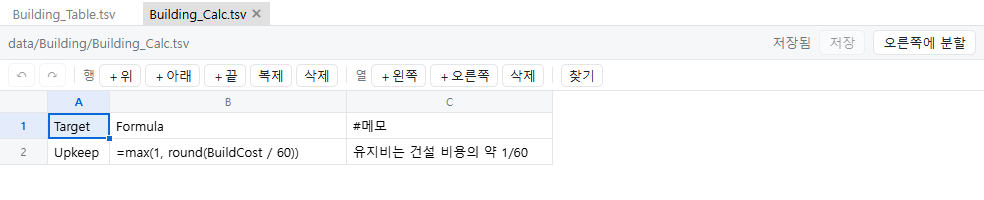
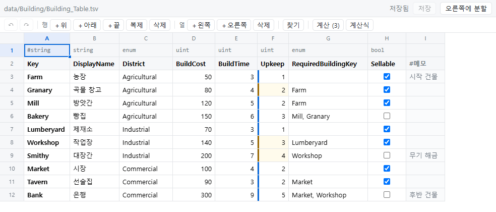
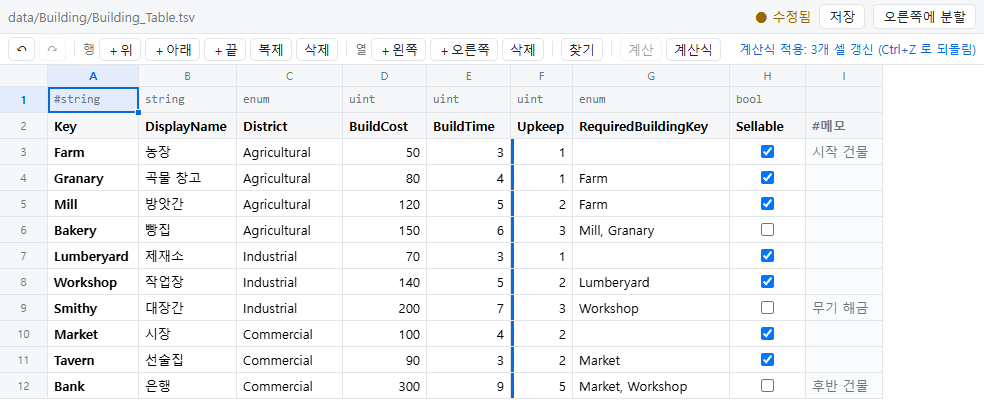

# 5. 계산식 (`_Calc.tsv`)

[← 사용 가이드 목차](../../README.md#사용-가이드)

엑셀처럼 열 값을 식으로 채우고 싶은데, **게임이 읽는 테이블 파일에는 식이 아니라 값만 남기고 싶을 때** 써요.

`X_Table.tsv` 옆에 `X_Calc.tsv` 를 두면 그 식으로 값을 계산해요. 식은 Calc 파일에만 있고, 표 파일에는 결과 값만 들어가요.

## 만들기

1. 표를 열고 툴바의 **계산식 만들기** 를 눌러요. 같은 폴더에 `X_Calc.tsv` 가 생기고 열려요. (이미 있으면 **계산식** 버튼으로 열어요.)
2. 규칙을 적어요. 1행은 머리글(`Target`), 2행부터 규칙이에요.



```
Target	Formula	#메모
Upkeep	=max(1, round(BuildCost / 60))	유지비는 건설 비용의 약 1/60
Upkeep[Bank]	=10	은행만 따로
```

- `열이름` 은 모든 행, `열이름[Key]` 는 그 Key 행 하나에만 적용(아래 규칙이 이겨요).
- `#` 로 시작하는 Target 은 주석이에요.

## 확인하고 적용하기

표로 돌아오면 식이 걸린 칸 왼쪽에 **파란 띠**, 지금 값이 식과 다른 칸은 **노란 배경**으로 보여요. 툴바에는 바뀔 칸 수가 `계산 (3)` 처럼 나와요.



**계산 (n)** 버튼이나 **`F9`** 를 누르면 바뀔 칸을 한꺼번에 써 넣어요. 되돌리기 한 번(`Ctrl+Z`)으로 취소돼요.



## 식에 쓸 수 있는 것

| 종류 | 예 |
|---|---|
| 값 | `12`, `"Peak"`, 열 이름 (`BuildCost`) |
| 계산 | `+ - * / %` |
| 비교 · 논리 | `== != > < >= <=` · `&& || !` |
| 조건 | `조건 ? a : b`, `if(조건, a, b)` |
| 숫자 함수 | `min max abs floor ceil round(x, 자릿수) num` |
| 글자 함수 | `len upper lower trim concat` |
| 리스트 칸 | `contains(리스트칸, "항목")`, `count(리스트칸)` |
| 다른 표 값 | `lookup("data/Item/Item_Table.tsv", 키값, "열이름")` |

- 빈 칸은 숫자 계산에서 0 이에요.
- 한 규칙이 다른 규칙의 결과를 읽어도 돼요(값이 안정될 때까지 다시 계산해요).
- 식이 틀리면 표 위에 빨간 배너로 알려 줘요.

---

[← 4. 문서 안에 표 넣기](tsv-view.md) · 다음: [6. 작업 환경 →](workspace.md)
