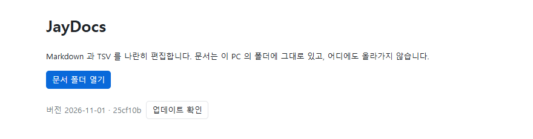
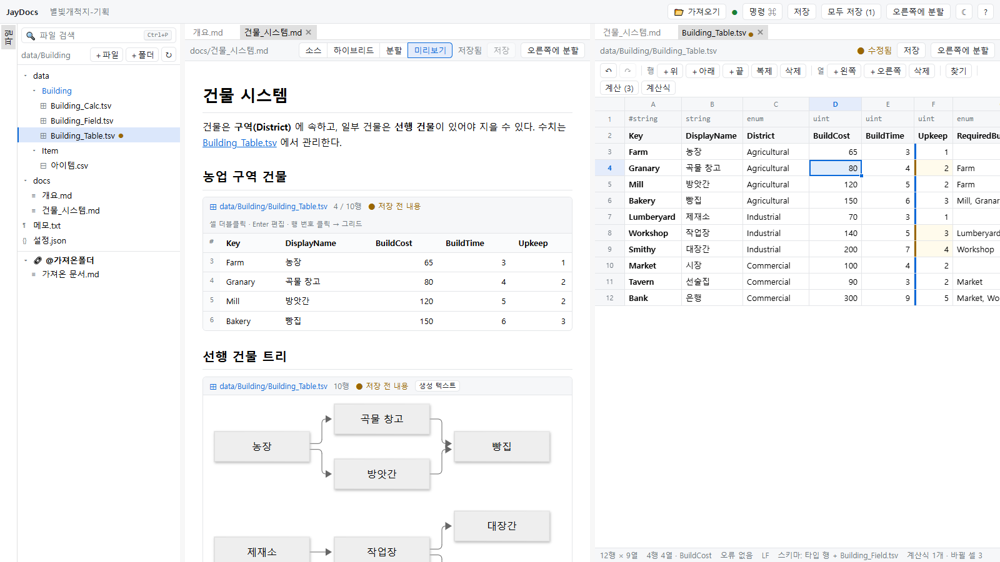

# 1. 시작하기

[← 사용 가이드 목차](../../README.md#사용-가이드)

설치 파일도, 회원 가입도 없어요. 브라우저로 주소를 열고 내 PC 의 폴더 하나를 고르면 끝이에요.

## 준비물

- **Windows PC + Edge** (Chrome 도 됩니다. Firefox · Safari · 모바일은 폴더를 열 수 없어서 안 돼요.)
- 연습용 폴더 하나. 처음엔 **복사본이나 git 으로 관리하는 폴더**로 써 보세요. JayDocs 는 진짜 파일을 바로 고쳐요.

## ① 주소 열기 · 앱으로 설치

Edge 에서 **https://krkoohoo.github.io/JayDocs/** 를 열면 시작 화면이 나와요.



위쪽(또는 주소창 오른쪽)에 **앱으로 설치** 가 보이면 눌러 주세요. 그러면 시작 메뉴 · 작업 표시줄에서 일반 프로그램처럼 열 수 있어요.

> 💡 **설치해서 쓰는 걸 권해요.** 브라우저 탭으로 쓰면 창을 닫을 때마다 폴더 권한을 다시 물을 수 있어요.

## ② 문서 폴더 열기

1. **문서 폴더 열기** 를 누르고 폴더를 골라요.
2. 브라우저가 "이 사이트가 파일을 보고 수정하도록 허용할까요?" 하고 물으면 **허용** 을 눌러요. (이 권한이 있어야 저장이 돼요.)
3. **문서 별칭 · 상세 경로** 를 묻는 창이 뜨는데, **건너뛰어도 돼요.**
   - 별칭: 최근 폴더 목록에 보일 이름 (예: `별빛개척지 기획`)
   - 상세 경로: 탐색기 주소창의 경로 (예: `D:\Work\Starlight\Docs`). 넣어 두면 **파일 탐색기에서 열기 · 전체 경로 복사** 가 돼요. 브라우저가 실제 경로를 알려 주지 않아서 직접 넣는 거예요. 경로 끝이 고른 폴더 이름과 다르면 저장되지 않아요.

다음부터는 바로 열려요. 권한이 풀려 있으면 시작할 때 **허용** 을 한 번만 누르면 돼요. 최근에 연 폴더(최대 10개)는 시작 화면에서 바로 고를 수 있어요.

## ③ 화면 둘러보기



| 위치 | 하는 일 |
|---|---|
| **왼쪽 파일 트리** | 폴더 안의 `.md` `.tsv` `.csv` `.txt` `.json` 이 보여요. 누르면 탭으로 열려요. 위의 🔍 **파일 검색** 으로 이름을 쳐서 찾을 수도 있어요. |
| **가운데 탭** | 연 문서들. 탭을 끌어서 오른쪽에 놓으면 화면이 나뉘어요. |
| **맨 위 막대** | 폴더 이름(눌러서 다른 폴더로 바꾸기) · 📂 가져오기 · 명령 · 저장 · 모두 저장 · 오른쪽에 분할 · 다크 모드 · 도움말 |
| **창 위 막대** | 마크다운이면 보기 모드(소스/하이브리드/분할/미리보기), 표면 행 · 열 · 찾기 · 계산 버튼 |
| **아래 상태 줄** (표) | 크기, 지금 칸, 오류 수, 줄바꿈 방식, 스키마 정보 |

## ④ 열고 · 고치고 · 저장하기

- 트리에서 파일을 누르면 열려요. 탭 이름 옆 **`●`** 는 아직 저장 안 했다는 표시예요.
- **`Ctrl+S`** 저장, **`Ctrl+Shift+S`** 모두 저장.
- 트리에서 **오른쪽 클릭** → 이름 바꾸기 / 옮기기 · 삭제 · 새 파일 · 새 폴더 · 파일 탐색기에서 열기 · 전체 경로 복사.

> ⚠️ **앱에서 지운 파일은 휴지통으로 가지 않아요.** 지우기 전에 한 번 더 확인해 주세요.

## 연습용 파일 만들기

아무 폴더에 `Sample.tsv` 를 만들어 아래 내용을 붙여 넣고(칸 사이는 **탭**) JayDocs 에서 열어 보세요. 첫 줄이 타입, 둘째 줄이 머리글이에요.

```
#string	uint	bool
Key	Cost	Sellable
Sword	100	TRUE
Shield	80	FALSE
```

- `Cost` 에 `-5` 나 `abc` 를 넣으면 빨간 밑줄이 생겨요. (uint 는 0 이상의 정수)
- `Sellable` 칸은 체크박스로 보이고 `Space` 로 켜고 꺼요.

자세한 표 기능은 [표 편집 가이드](table.md) 에 있어요.

---

다음: [2. 마크다운 문서 쓰기 →](markdown.md)
