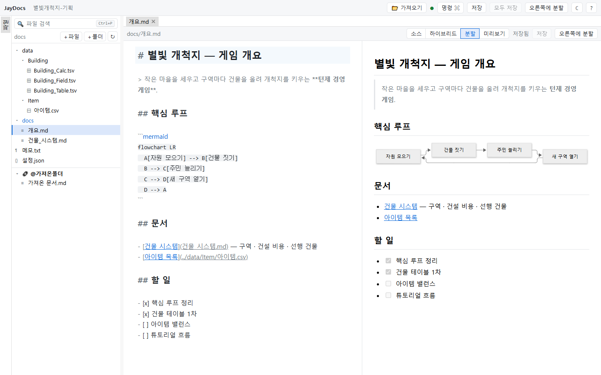
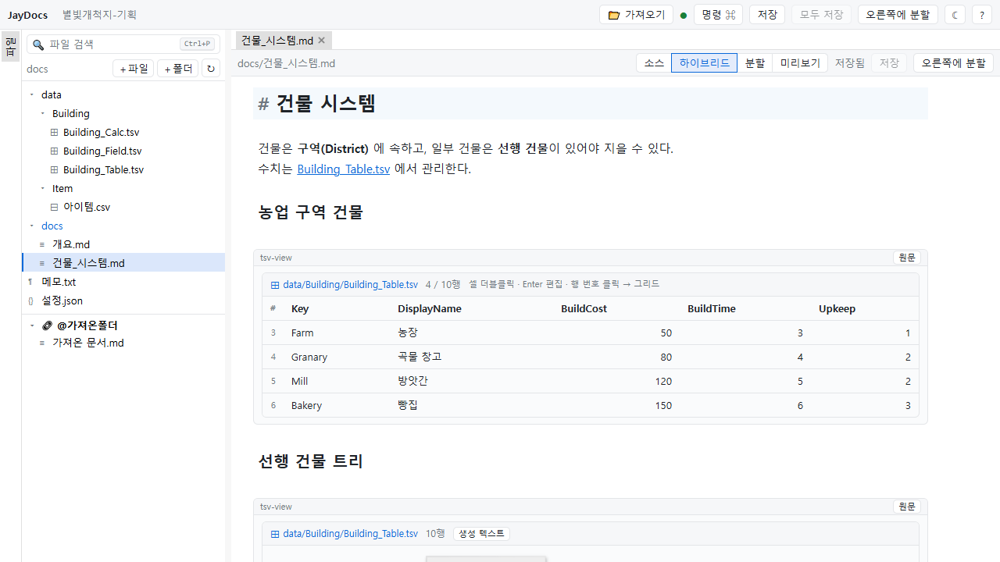
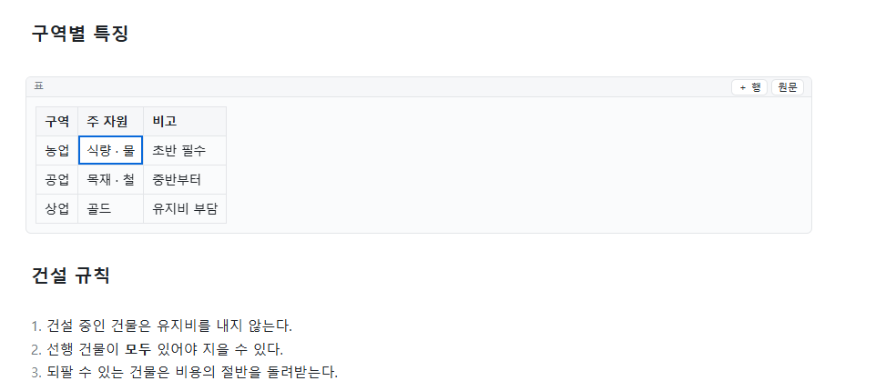
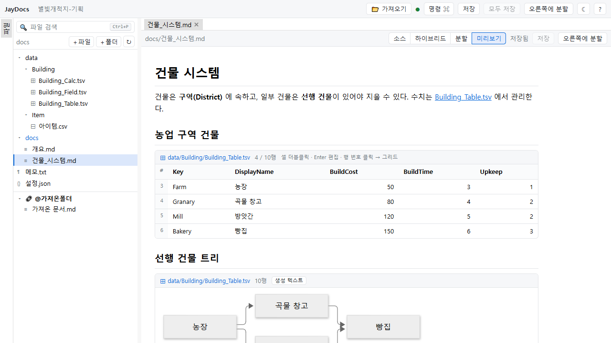

# 2. 마크다운 문서 쓰기

[← 사용 가이드 목차](../../README.md#사용-가이드)

`.md` 파일을 열면 위쪽에 **소스 / 하이브리드 / 분할 / 미리보기** 버튼이 있어요. `Ctrl+Shift+V` 로 돌아가며 바꿀 수도 있어요. 어느 모드든 **파일에는 마크다운 원문 그대로** 저장돼요.

## 보기 모드 4가지

| 모드 | 이런 때 |
|---|---|
| **소스** | 원문을 그대로 보며 쓸 때 |
| **하이브리드** | 옵시디언처럼 — 커서가 있는 줄만 원문, 나머지는 꾸며진 모습. **가장 추천해요.** |
| **분할** | 왼쪽 원문 · 오른쪽 미리보기를 나란히 |
| **미리보기** | 읽기 전용 화면. 문서 확인 · 공유 화면용 |

### 분할



Mermaid 다이어그램, 체크박스, 링크가 오른쪽에 바로 그려져요.

### 하이브리드



- `#` `**` `` ` `` 같은 표식은 숨고, 커서를 그 줄에 두면 원문이 보여요.
- ```` ```mermaid ```` · ```` ```tsv-view ```` 블록은 커서가 밖에 있으면 그림 · 표로 보이고, 블록 위의 **원문** 을 누르면 원문으로 돌아와요.
- `- [ ]` 할 일은 체크박스를 눌러 `[x]` 로 바꿀 수 있어요.
- `` 은 줄 아래에 그림이 붙어요.

**마크다운 표를 칸 단위로 고칠 수 있어요.** 표 칸을 누르면 바로 편집돼요.



- `Tab` / `Shift+Tab` 옆 칸 (마지막 칸에서 `Tab` 은 새 행), `Enter` · `↑↓` 위아래 칸, `Esc` 로 끝.
- 바뀌는 건 그 칸의 글자뿐이라 다른 칸의 정렬 공백은 그대로예요.
- 그 밖의 ```` ``` ```` 코드 블록은 코드 상자로 보이고 그 자리에서 고쳐요. 언어를 적으면 색도 들어가요([코드 블록](#코드-블록)).

**왼쪽에 목차가 떠요.** 문서의 제목(`#` `##` `###` …)이 단계별로 들여 쓰여 나오고, 지금 보고 있는 절의 제목이 칠해져요.

- 제목을 누르면 그 제목이 편집기 맨 위로 와요.
- `Ctrl+Alt+T` 로 목차에 들어가 `↑` `↓` 로 고르고 `Enter` 로 가요. `Space` 는 가기만 하고 목차에 남고, `Esc` 는 편집기로 돌아가요.
- 창 막대의 **목차** 버튼(또는 팔레트 "목차 보이기 / 숨기기")으로 끄고 켜요. 하이브리드 모드에서만 보이고, 창이 좁으면 저절로 숨어요.
- 코드 블록 안의 `#` 은 목차에 나오지 않아요.

### 미리보기



## 링크 · 그림

- 문서 안의 `.md` · `.tsv` · `.csv` 링크를 누르면 **그 파일이 새 탭으로** 열려요.
  - 경로는 그 md 파일 위치 기준이에요. `/` 로 시작하면 폴더 맨 위 기준.
  - 예: `[건물 시스템](건물_시스템.md)`, `[건물 표](../data/Building/Building_Table.tsv)`
- 그림은 `` 처럼 폴더 안 경로를 쓰면 보여요(png · jpg · gif · webp · svg · bmp · avif). 인터넷 주소도 돼요.

## 코드 블록

````markdown
```csharp
private async UniTaskVoid ResolveTurnAsync(string playerId, int d1)
{
    await Turn.ShowDiceResultAsync(d1);   // 주사위 결과 연출
}
```
````

- 펜스 뒤에 언어를 적으면 Visual Studio 처럼 색이 들어가요 — 키워드 · 타입 · 메서드 · 변수 · 주석 · 문자열이 서로 다른 색이에요. 소스 · 하이브리드 · 미리보기 어디서나 같은 색이고, 밝은 · 어두운 테마를 따라가요.
- 되는 언어: `csharp`(`cs` · `c#`) · `hlsl` · `shaderlab` · `json` · `jsonc` · `yaml` · `xml` · `html` · `css` · `javascript`(`js`) · `typescript`(`ts`) · `python`(`py`) · `lua` · `bash`(`sh`) · `powershell` · `bat` · `ini` · `sql` · `diff`. 그 밖의 언어는 색 없이 보여요.
- 그 언어의 블록을 처음 볼 때 한 번은 색 없이 보이다가 곧 칠해져요.
- 400줄이 넘는 블록은 색을 넣지 않아요(입력이 느려지지 않게).

## Mermaid 다이어그램

````markdown

````

순서도 · 시퀀스 · 상태도 등 [Mermaid](https://mermaid.js.org/) 문법을 그대로 써요. **표 데이터로 다이어그램을 자동으로 그리는 방법**은 [문서 안에 표 넣기](tsv-view.md#표로-다이어그램-그리기) 에 있어요.

## 편집 단축키 (자주 쓰는 것)

| 키 | 동작 |
|---|---|
| `Ctrl+F` | 찾기 |
| `Ctrl+H` | 바꾸기 — 찾기 패널의 바꾸기 칸으로 (표의 `Ctrl+H` 와 같아요) |
| `Ctrl+D` | 같은 단어 하나 더 선택 (여러 커서) |
| `Ctrl+클릭` | 커서 추가 |
| `Alt+드래그` | 사각형 선택 |
| `Alt+↑ / ↓` | 줄 옮기기 |
| `Shift+Alt+↓` | 줄 복제 |

## `.txt` · `.json` 도 열려요

- **`.txt`** — 고정폭 글꼴의 평범한 편집기. 찾기 · 여러 커서 · 되돌리기는 마크다운과 같아요.
- **`.json`** — 색 구분 + 문법 검사(창 위 `JSON ✓` / `JSON 오류`). 문법이 틀려도 저장은 돼요.
  - 창 위 **정렬** 버튼으로 들여쓰기 2칸으로 다시 정리해요. 저절로는 하지 않아요(git diff 가 통째로 바뀌니까요). 정렬하면 내용이 바뀌는 파일(`1.0` → `1`, 중복 키 등)은 건드리지 않고 알려 줘요.

---

[← 1. 시작하기](getting-started.md) · 다음: [3. 표 편집 (TSV · CSV) →](table.md)
