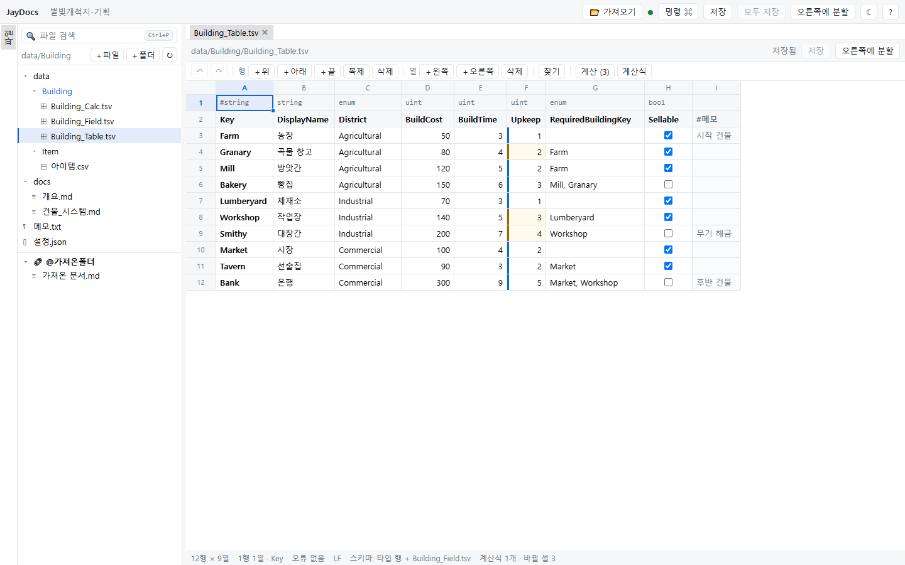
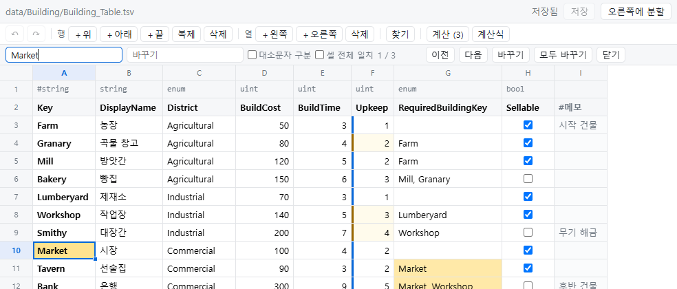
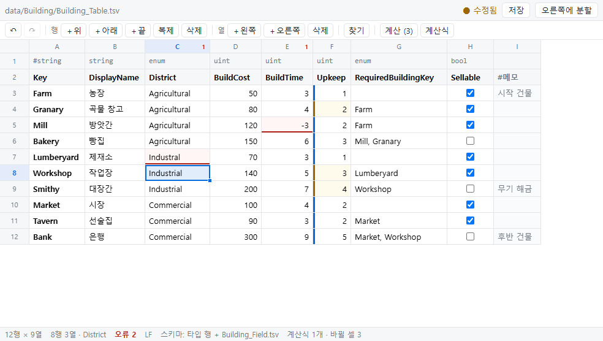
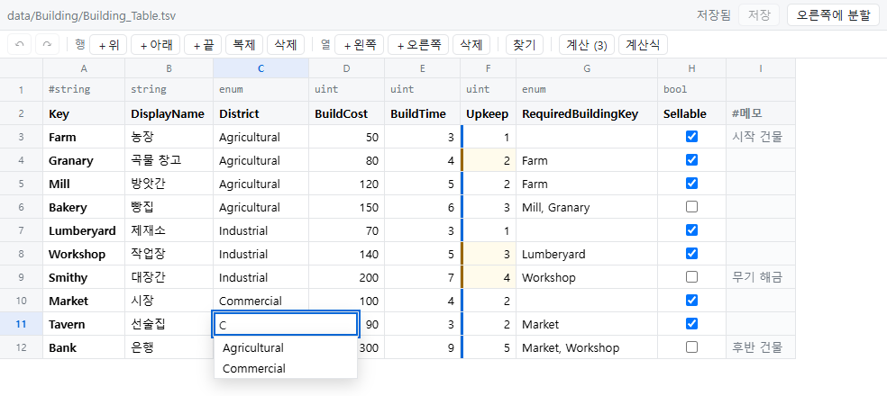
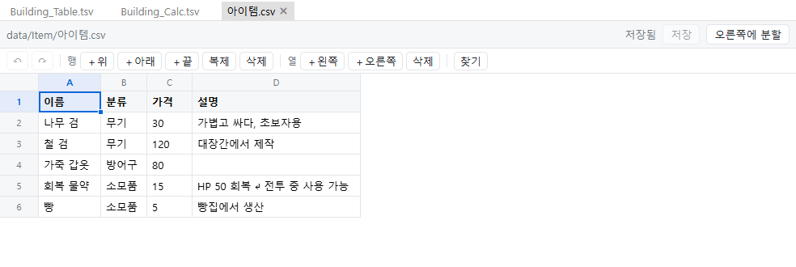

# 3. 표 편집 (TSV · CSV)

[← 사용 가이드 목차](../../README.md#사용-가이드)

`.tsv` · `.csv` 파일은 **스프레드시트 같은 그리드**로 열려요. 엑셀 · 구글 시트에서 쓰던 조작이 거의 그대로 되고, 저장할 때는 **고친 줄만** 다시 써서 git diff 가 깔끔하게 나와요.



## 기본 조작

| 하고 싶은 것 | 방법 |
|---|---|
| 칸 이동 | 방향키 · `Tab` / `Shift+Tab` · `Home` / `End` · `Ctrl+방향키`(표 끝으로) |
| 값 입력 | 칸을 고르고 **그냥 타이핑** (덮어쓰기) |
| 기존 값 이어 쓰기 | `Enter` 또는 `F2` |
| 확정 | `Enter`(아래로) · `Tab`(오른쪽으로), 취소는 `Esc` |
| 되돌리기 | `Ctrl+Z` / `Ctrl+Y` |
| 범위 선택 | `Shift+방향키` · 드래그 · 행 번호 / 열 글자 클릭 · `Ctrl+A` |
| 복사 · 붙여넣기 | `Ctrl+C` / `Ctrl+X` / `Ctrl+V` — **구글 시트 · 엑셀과 서로 주고받기 돼요** |
| 비우기 | `Delete` |
| 아래로 · 오른쪽으로 채우기 | `Ctrl+D` / `Ctrl+R` |

> **한글 입력이 안 깨져요.** 칸을 고르고 바로 한글을 쳐도 첫 자모가 빠지지 않아요.

### 붙여넣기 더 알기

- 표 끝을 넘는 행은 새로 추가되고, 너비를 넘는 열은 잘라 내고 알려 줘요.
- 한 칸을 복사해서 범위에 붙이면 범위 전체가 그 값으로 채워져요.
- **마크다운 표**(md 원문의 `| a | b |` 표, 미리보기에서 복사한 표)를 붙이면 머리글은 머리글 행으로 가고, 모자라는 열 · 행은 늘려요.

### 채우기 핸들

범위 오른쪽 아래의 **작은 네모**를 끌면 이어 채워요.

- `1, 2` 를 골라 끌면 `3, 4, 5…` 처럼 수열을 이어요(소수 자릿수도 유지).
- 그 밖의 값은 무늬를 되풀이해요. 숫자 한 칸만 끌면 복사.
- 표 끝을 넘으면 행이 생겨요. 되돌리기 한 번으로 취소돼요.

## 찾기 · 바꾸기

`Ctrl+F`(찾기) · `Ctrl+H`(바꾸기) — 그리드 위에 막대가 열리고, 걸린 칸은 노랗게 칠해져요.



- `Enter` · `F3` 다음, `Shift+Enter` · `Shift+F3` 이전.
- **대소문자 구분 · 셀 전체 일치** 를 고를 수 있어요.
- **바꾸기** 는 지금 칸만, **모두 바꾸기** 는 한 번에(되돌리기 한 번으로 취소).

## 행 · 열 다루기

툴바의 **행 / 열** 버튼이나 단축키를 써요. 고른 범위만큼 여러 줄에 한꺼번에 적용돼요.

| 동작 | 키 |
|---|---|
| 아래에 행 삽입 / 행 삭제 | `Ctrl+Alt+=` / `Ctrl+Alt+-` |
| 오른쪽에 열 삽입 / 열 삭제 | `Ctrl+Alt+Shift+=` / `Ctrl+Alt+Shift+-` |
| 행 복제 | `Ctrl+Shift+D` |
| 열 옮기기 | 열 글자(A, B, C…)를 누른 채 옆으로 끌기 |

> 열을 넣거나 빼거나 옮기면 모든 줄이 바뀌어 git diff 가 커져요. 묻지 않고 바로 하고, 오른쪽 아래 알림의 **되돌리기** 나 `Ctrl+Z` 로 되돌릴 수 있어요.

## 데이터 검증 (타입 행)

표의 **첫 줄에 타입**을 적어 두면 JayDocs 가 값을 검사해요. 둘째 줄은 머리글로 보고 위에 고정돼요.

```
#string	string	enum	uint	uint	bool
Key	DisplayName	District	BuildCost	BuildTime	Sellable
Farm	농장	Agricultural	50	3	TRUE
```

| 타입 | 뜻 |
|---|---|
| `string` | 아무 글자 |
| `int` | 정수 (음수도 됨) |
| `uint` | 0 이상의 정수 |
| `byte` | 0 ~ 255 |
| `float` | 소수 |
| `bool` | 체크박스 (`TRUE` / `FALSE`, `Space` 로 전환) |
| `enum` | 정해진 값 중 하나 — 입력할 때 후보가 뜸 |
| (비움) 또는 머리글이 `#메모` | 주석 열 (회색, 검사 안 함) |

- 첫 열 이름이 `Key` 면 **중복 Key** 도 찾아 줘요.
- 틀린 값은 **빨간 밑줄**, 열 글자 옆에 오류 개수, 아래 상태 줄에 `오류 n` 이 보여요. 마우스를 올리면 이유가 나와요. **저장을 막지는 않아요.**



### enum 후보와 열 설명 (`_Field.tsv`)

`Building_Table.tsv` 옆에 `Building_Field.tsv` 를 두면 enum 후보와 열 설명을 거기서 읽어요. 빈 줄로 블록을 나누고, 블록 첫 칸이 이름이에요.

```
BuildingDef	설명
BuildCost	건설 비용 (골드)
BuildTime	건설에 걸리는 턴 수

District	설명
Agricultural	농업 구역
Industrial	공업 구역
Commercial	상업 구역
```

- `표이름Def` 블록(`BuildingDef`) → **열 설명** (열 글자 위에 마우스를 올리면 보여요)
- 열 이름과 같은 블록(`District`) → 그 enum 열의 **허용 값**
- Field 파일이 없으면 그 열에 이미 들어 있는 값들을 후보로 써요.

enum 칸을 편집하면 아래에 후보가 떠요. 글자를 치면 걸러지고, `↓` 로 골라 `Enter`.



`Mill, Granary` 처럼 쉼표로 여러 값을 넣는 리스트 열은 마지막 항목만 자동 완성돼요.

## CSV

`.csv` 도 같은 그리드로 열리고 기능이 모두 같아요. 타입 행이 없으면 **첫 줄을 머리글**로 봐요.



- 칸 안의 쉼표 · 따옴표 · 줄바꿈도 제대로 읽고 써요. 칸 안 줄바꿈은 `↵` 로 보이고, 편집 중 **`Alt+Enter`** 로 줄을 바꿔요(엑셀처럼).
- 한글 엑셀의 **"CSV(쉼표로 분리)"** 형식은 옛 인코딩(CP949)이라 🔒 읽기 전용으로 열려요. 배너의 **UTF-8 로 바꿔 저장** 을 누르면 엑셀에서도 한글이 잘 보이는 UTF-8 로 바뀌고 그 뒤로는 편집돼요.
- 문서 안에 표 넣기(`tsv-view`)의 `file:` 에 `.csv` 도 쓸 수 있어요. `_Field` 짝짓기와 계산식(`_Calc`)은 TSV 전용이에요.
- 따옴표가 안 맞는 칸은 읽을 수 있는 만큼 읽고 열 때 알려 줘요. 세미콜론(`;`)으로 나눈 CSV 는 아직 안 돼요.

## C# DTO 클래스 만들기

표를 열고 **`Ctrl+Alt+E`** (또는 팔레트 "C# DTO 내보내기")를 누르면 표의 머리글로 C# 클래스 파일(`.cs`)을 만들어요. 표를 읽는 쪽이 머리글 이름과 필드 이름을 글자 그대로 맞추는 경우(CsvHelper 등)에, 손으로 옮겨 적다 생기는 오타를 없애려는 기능이에요.

```
ID	PrefabKey	MaxHp	Speed
0	Enemy/Enemy_00	100	2.0
1	Enemy/Enemy_01	60	3.5
```

```csharp
// <auto-generated>
// JayDocs 가 enemies.tsv 의 머리글에서 만든 파일입니다.
// 직접 고치지 마세요 — 표를 고친 뒤 다시 내보내면 덮어씁니다.
// </auto-generated>

/// <summary>enemies.tsv 의 한 행.</summary>
public class EnemyDTO
{
    public int ID;
    public string PrefabKey;
    public int MaxHp;
    public float Speed;
}
```

- **자료형은 `int` · `float` · `string` 셋뿐이에요.** enum 값 · 경로 · `T`/`F` 같은 값은 모두 `string` 으로 받고, 해석은 그 값을 쓰는 코드에서 해요.
- **타입 행이 있으면 거기 적힌 대로** — `int` · `byte` · `uint` 는 `int`, `float` 는 `float`, 나머지는 `string`. 타입이 빈 열(주석 열)은 빠져요.
- **타입 행이 없으면 데이터를 보고 정해요.** 그 열의 모든 칸이 정수면 `int`, 소수가 섞인 숫자면 `float`, 빈 칸이 하나라도 있거나 다른 글자가 섞이면 `string`.
- `#` 로 시작하는 줄은 주석으로 보고 건너뛰어요. 그 아래 첫 줄이 머리글이에요. `#` 로 시작하는 머리글(주석 열)도 빠져요.
- 열 설명(`_Field.tsv` 의 `표이름Def` 블록, 또는 머리글 바로 위의 `#설명` 줄)이 있으면 필드 위에 `/// <summary>` 로 들어가요.
- 공백이 든 머리글처럼 C# 이름으로 쓸 수 없는 열, 이름이 겹치는 열은 빼고 알려 줘요(파일 머리 주석에도 남아요).

**경로는 처음 한 번만 물어요.** 파일 이름이 곧 클래스 이름이에요(`EnemyDTO.cs` → `class EnemyDTO`). 다른 폴더(Unity 프로젝트 등)에 쓰려면 먼저 [폴더 가져오기](workspace.md)로 그 폴더를 열고 `@별칭/Assets/Scripts/Data/EnemyDTO.cs` 처럼 적어요. 그 뒤로는 `Ctrl+Alt+E` 가 **묻지 않고 같은 파일을 덮어써요.** 경로나 클래스 이름을 바꾸려면 팔레트의 "C# DTO 내보내기 — 경로 · 클래스 이름 바꾸기…".

- 내용이 그대로면 파일을 다시 쓰지 않아요(Unity 가 다시 컴파일하지 않게).
- 덮어쓰는 것은 JayDocs 가 만든 파일(첫 줄의 `<auto-generated>` 표식)뿐이에요. 손으로 쓴 파일이 그 자리에 있으면 먼저 물어요.
- 저장하지 않은 편집도 들어가요. 경로는 이 브라우저에만 기억돼요.
- `.cs` 파일은 JayDocs 의 파일 트리에 보이지 않아요.

## 원본을 망가뜨리지 않아요

- **고친 행만** 다시 써요. 손대지 않은 행은 바이트 그대로예요.
- 줄바꿈 방식(CRLF / LF) · BOM · 끝 개행 · 따옴표 스타일도 파일에 있던 그대로 둬요.
- 끝 개행이 없는 파일은 상태 줄의 **끝 개행 추가** 를 한 번 눌러 두면, 다음에 행을 추가할 때 diff 가 한 줄로 나와요.
- 엑셀이 파일을 열어 잠그고 있으면 저장이 막히고, 원본은 그대로예요.

---

[← 2. 마크다운](markdown.md) · 다음: [4. 문서 안에 표 넣기 →](tsv-view.md)
