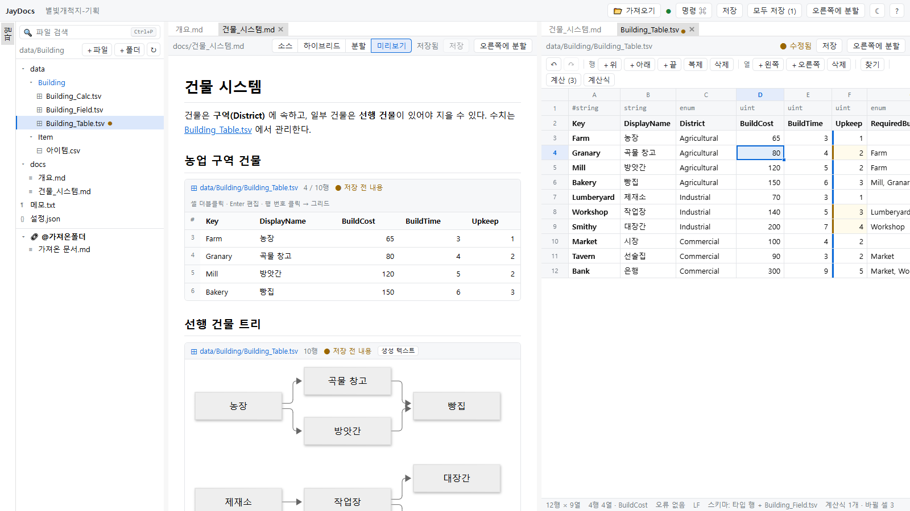
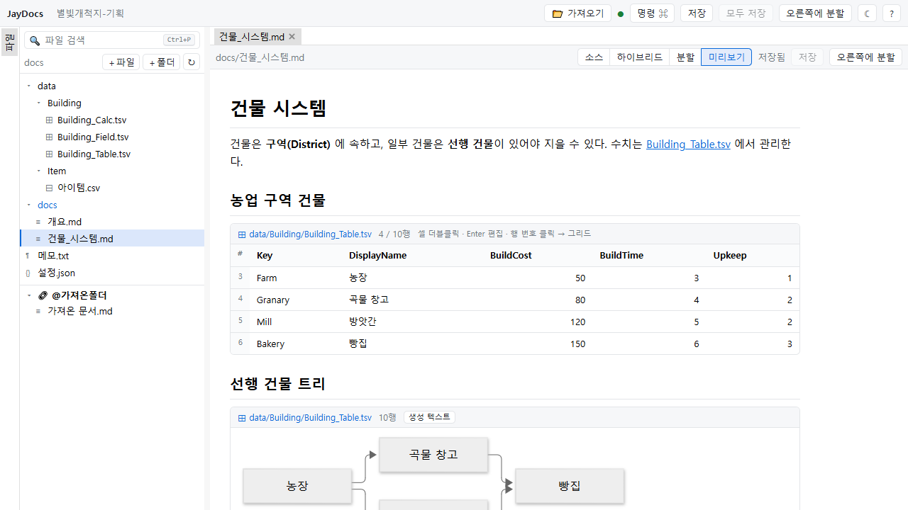
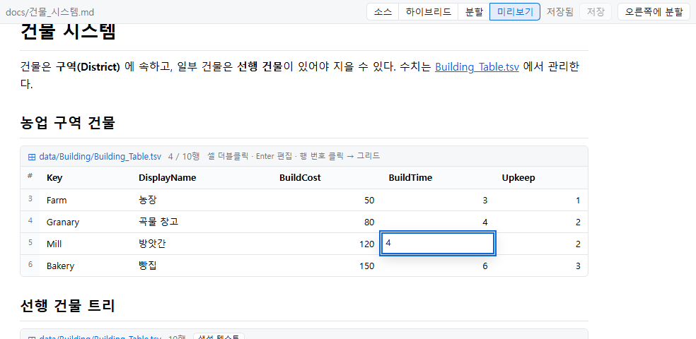
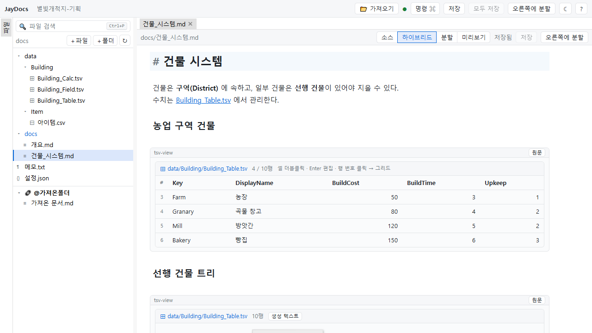

# 4. 문서 안에 표 넣기 (`tsv-view`)

[← 사용 가이드 목차](../../README.md#사용-가이드)

기획서에 수치표를 **복사해 붙이지 말고 연결**하세요. 표 파일 값이 바뀌면 문서 속 표도 같이 바뀌어서, "문서에 적힌 값"과 "실제 테이블 값"이 어긋날 일이 없어요.



*오른쪽 표에서 Farm 의 BuildCost 를 50 → 65 로 고치자, 왼쪽 문서의 표가 바로 따라 바뀌고 `● 저장 전 내용` 표시가 붙었어요.*

## 기본 쓰는 법

md 문서에 ```` ```tsv-view ```` 블록을 넣어요.

````markdown
```tsv-view
file: data/Building/Building_Table.tsv
columns: [Key, DisplayName, BuildCost, BuildTime, Upkeep]
where: District == "Agricultural"
sort: BuildCost
```
````

미리보기 · 하이브리드에서 이렇게 보여요.



| 항목 | 뜻 | 예 |
|---|---|---|
| `file` | **(필수)** 표 파일 경로. 폴더 맨 위 기준, `./` `../` 로 시작하면 이 md 위치 기준 | `data/Building/Building_Table.tsv` |
| `columns` | 보여 줄 열 (생략하면 주석 열 빼고 전부) | `[Key, BuildCost]` |
| `where` | 조건 | `BuildCost > 100 && District != "Commercial"` |
| `sort` | 정렬. `-` 를 붙이면 내림차순, 여러 개 가능 | `-BuildCost` |
| `limit` | 최대 행 수 | `3` |

### `where` 에 쓸 수 있는 것

- 비교: `==` `!=` `>` `<` `>=` `<=` — 숫자끼리는 숫자로 비교해요.
- 목록: `District in ["Agricultural", "Industrial"]`, `not in`
- 묶기: `&&`(그리고) `||`(또는) `!`(아님), 괄호
- `Mill, Granary` 같은 리스트 칸은 `in` 이 항목 하나하나에 걸려요.

## 문서 안에서 바로 고치기

미리보기 · 하이브리드의 표에서 **칸을 더블클릭**(또는 고르고 `Enter` / `F2`, 바로 타이핑)하면 그 자리에서 값을 고칠 수 있어요.



- `Tab` / `Enter` 로 옆 · 아래 칸, `Delete` 로 비우기, `Ctrl+Z` 되돌리기.
- 고친 값은 **원래 표 파일**에 들어가요. 그래서 저장도 그 표 파일 쪽(`Ctrl+Shift+S` 모두 저장이 편해요)에서 해요.
- 행 번호를 누르거나 `Ctrl+Enter` 를 누르면 그 행이 그리드로 열려요.

## 표로 다이어그램 그리기

`render: mermaid` 와 `template` 을 쓰면 표의 행들로 Mermaid 다이어그램을 만들어요. 예를 들어 **선행 건물 트리**를 자동으로 그릴 수 있어요.

````markdown
```tsv-view
file: data/Building/Building_Table.tsv
render: mermaid
template: |
  flowchart LR
  {{#each rows}}
  {{Key.id}}["{{DisplayName}}"]
  {{#each RequiredBuildingKey.list}}
  {{this.id}} --> {{../Key.id}}
  {{/each}}
  {{/each}}
```
````



표에 건물을 추가하면 트리도 저절로 늘어나요.

| 템플릿 문법 | 뜻 |
|---|---|
| `{{Key}}` | 그 행의 `Key` 열 값 |
| `{{Key.id}}` | Mermaid id 로 안전하게 바꾼 값 |
| `{{#each rows}} … {{/each}}` | 행마다 되풀이 |
| `{{#each Col.list}} … {{/each}}` | `A, B` 리스트 칸의 항목마다 되풀이 (`{{this}}` 가 항목) |
| `{{../Key}}` | 바깥 행의 값 |
| `{{@index}}` | 순번 |
| `{{#if Col}} … {{else}} … {{/if}}` | 값이 있을 때만 |

문법이 틀리면 생성된 글과 오류를 보여 줘요. 표시줄의 **생성 텍스트** 로 결과 글을 볼 수 있어요.

## GitHub 에서도 표가 보이게 (`bake`)

블록에 `bake: true` 를 넣으면, md 를 저장할 때 블록 바로 아래에 진짜 마크다운 표를 다시 써 줘요. GitHub 웹에서 볼 때도 표가 보이는 대신, 파생 내용이 diff 에 섞여요. 기본은 꺼져 있어요.

---

[← 3. 표 편집](table.md) · 다음: [5. 계산식 →](calc.md)
