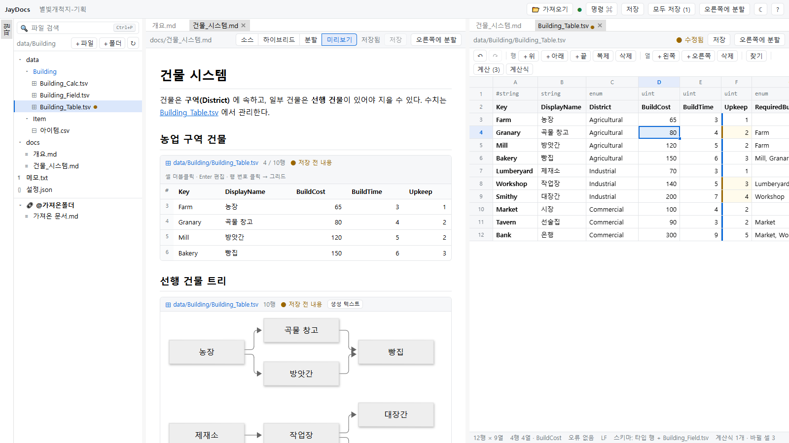
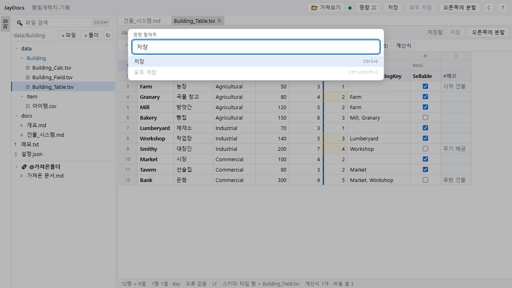
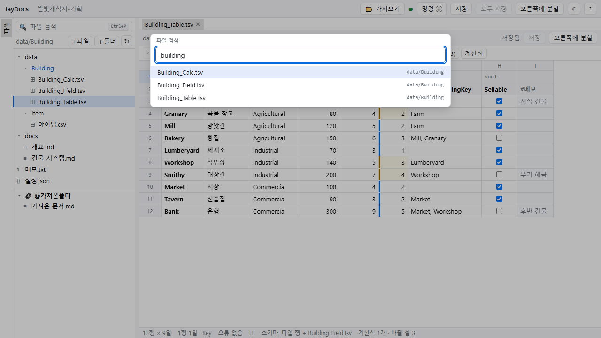

# 6. 작업 환경 — 탭 · 분할 · 폴더 · 키보드

[← 사용 가이드 목차](../../README.md#사용-가이드)

## 탭 · 화면 나누기

- **탭을 끌어서** 오른쪽(또는 아래)에 놓으면 화면이 나뉘어요.
- **오른쪽에 분할** (`Ctrl+\`) — 지금 문서를 오른쪽 창에도 열어요. 같은 문서를 두 창에 열면 **한쪽에서 고친 내용이 다른 쪽에 바로** 보여요.
- 문서는 왼쪽, 표는 오른쪽에 두고 쓰는 식이 편해요.

- 탭 이동 `Alt+]` / `Alt+[`, n번째 탭 `Alt+1~9`, 탭 닫기 `Alt+W`.
- 파일 트리 접기 `Ctrl+B`, 트리로 포커스 `Ctrl+Shift+E`, 문서 창으로 포커스 `Ctrl+Shift+M`.
- 트리에 포커스가 있으면 방향키로 다니고 `Enter` 열기, `F2` 이름 바꾸기, `Delete` 삭제, `Shift+F10` 오른쪽 클릭 메뉴.
- 트리에서 `Ctrl+F` 를 누르면 트리 위에 필터 칸이 열려요. 이름 일부를 치면 그 글자가 든 파일 · 폴더만 폴더 구조째 남아요(`/` 를 치면 경로에서 찾아요). `↓` 로 트리에 내려가 열고, `Esc` 로 지워요. 칸 옆 ● 는 저장 안 한 파일만 보여 줘요.
- 자주 여는 문서 · 폴더는 **고정**해 두세요. 트리에서 오른쪽 클릭(`Alt+Enter`) → **고정**, 또는 팔레트 "현재 문서 고정". 트리 맨 위 "📌 고정" 에 모이고, `Ctrl+P` 를 열면 맨 위에 나와요. 고정한 폴더를 누르면 트리의 그 폴더로 가요.
- 탭 배치 · 열 너비 · 보기 모드는 기억해 두었다가 다음에 열 때 그대로 돌려놔요.

## 키보드로 전부 — 명령 팔레트 · 파일 검색

**`Ctrl+Shift+P` 명령 팔레트** — 모든 명령을 글자로 찾아 실행해요. 단축키가 기억 안 날 때 여기서 찾으면 돼요.

**`Ctrl+P` 파일 검색** (파일 트리 위 🔍 버튼) — 파일 이름 일부만 쳐도 찾아 열어요. 글자 순서만 맞으면 띄어쓰기 없이도 걸려요.

- `이름:12` 처럼 치면 그 파일의 12번째 줄로(표는 그 행), `#` 로 시작하면 지금 문서의 제목으로 가요.
- `Ctrl+Enter` 는 오른쪽 창에 열어요.
- 목록 맨 아래 **본문에서 ‘…’ 찾기** 를 고르면 파일 내용을 찾는 전체 검색으로 넘어가요.

**`Ctrl+Alt+F` 전체 검색** — 연 폴더(가져온 폴더 포함)의 문서 내용에서 글자를 찾아요. 결과는 파일마다 줄로 보이고, `Enter` 면 그 줄(표는 그 칸)로, `Ctrl+Enter` 면 오른쪽 창에 열어요. 저장하지 않은 편집도 찾고, 범위 단추로 지금 문서의 폴더만 찾을 수도 있어요.

**`Alt+,` 뒤로 · `Alt+.` 앞으로** — 문서를 열고 탭을 바꾸고 제목(목차 · 경로 막대 · `#제목`)으로 뛴 자리를 기억해요. 표를 확인하러 갔다가 `Alt+,` 하면 보던 문서의 그 줄로 돌아와요.

**폴더 격자 보기 · 정렬** — 폴더 격자(트리에서 폴더에 `Space`, 다시 `Tab`) 안에서 `Ctrl+Shift+V` 를 누르면 목록(이름 · 수정 시각 · 크기)으로 바뀌어요. 창 머리의 **수정 시각** 을 누르면 새로 고친 것부터 "오늘 · 어제 · 지난 7일 · 그 전" 으로 묶어 보여 줘요. 보기와 정렬은 다음에도 그대로예요.

**`Ctrl+Alt+[` 제목 접기 · `Ctrl+Alt+]` 펴기** — 마크다운에서 커서가 있는 절(제목 아래)을 접어요. 한 번 더 누르면 바깥 절까지 접혀요. 하이브리드 모드의 목차에서는 `←` 접기 · `→` 펴기예요. 접어 둔 것은 다음에 열어도 그대로이고, 파일은 바뀌지 않아요. 모두 접기 · 모두 펴기는 팔레트에 있어요.

**`F1` 단축키 목록** — 전체 단축키를 한 화면에서 봐요. ([SHORTCUTS.md](../../SHORTCUTS.md) 와 같은 내용)

**`Shift+F1` 단축키 안내 창** — 문서 창 왼쪽 아래의 작은 창이 지금 포커스가 있는 자리(파일 트리 · 표 · 셀 편집 · 편집기 · 마크다운 표 · 목차 · 경로 막대 …)에서 자주 쓰는 키를 보여 줘요. 자리를 옮기면 내용이 바뀌고, 맨 아래 `Alt+Enter` 는 그 자리의 모든 동작, `F1` 은 전체 표예요. 단축키가 있는 단추를 마우스로 누르면 "다음엔 …" 으로 그 키를 잠깐 알려 줘요. 처음엔 켜져 있고, `Shift+F1` 이나 창의 × 로 끄면 그대로 기억해요. ▾ 로 접을 수도 있어요.

## 다른 폴더 같이 열기 (가져오기)

수업 자료, Unity 프로젝트의 문서 폴더처럼 **다른 곳에 있는 폴더를 복사하지 않고 원래 자리에서** 같이 열어요.

1. `Ctrl+Shift+O` 또는 맨 위 **📂 가져오기**.
2. **폴더 고르기…** 로 폴더를 고르고 **가져오기**. 별칭은 비우면 폴더 이름이 돼요.
3. 트리 맨 아래에 `🔗 @별칭` 으로 붙어요.

**파일 탐색기에서 끌어다 놓아도 돼요.** 폴더나 파일을 파일 트리 위에 놓으면 가져오기 창이 그것으로 떠요 — `Enter` 만 누르면 끝이에요. 이미 열려 있는 폴더 안의 것이면 가져오지 않고 그 파일을 열어요(폴더면 트리에서 그 자리로 가요). 여러 개를 놓으면 첫 번째만 가져와요.

**파일 하나만 가져올 수도 있어요.** 같은 창(`Ctrl+Shift+O`)에서 **파일 고르기…** 를 누르거나, 파일을 트리에 끌어다 놓으세요. 트리에 `@파일이름` 과 그 아래 그 파일 하나가 붙어요.

- 그 파일을 고쳐 저장하는 것만 돼요. 새 파일 · 이름 바꾸기 · 지우기는 원래 폴더에서 하세요.
- 옆에 있는 그림 · 표(`tsv-view`) · `_Field` 는 읽지 못해요. 필요하면 폴더째 가져오세요.
- 읽기 전용 · 해제 · "최근" 목록은 폴더와 같아요.

- **보기만 할 폴더**(예: 수강생 제출물)는 먼저 **읽기 전용** 을 켜고 고르세요. 🔒 가 붙고 저장 · 삭제 · 이름 바꾸기가 막혀요.
- 트리의 `@별칭` 을 오른쪽 클릭하면 읽기 전용 켜기/끄기 · 새로 고침 · **가져오기 해제**(파일은 그대로)를 할 수 있어요.
- Unity 프로젝트를 통째로 가져와도 `Library` `Temp` `Logs` `obj` `Build` 같은 폴더는 저절로 빠져요. 다만 큰 프로젝트는 읽는 데 시간이 걸리니 문서 폴더만 고르는 편이 좋아요.
- 가져온 폴더의 파일 경로는 `@별칭/…` 이에요. 그 안의 md 에서 쓰는 `tsv-view` 의 `file:`, `/` 로 시작하는 링크, 계산식 `lookup` 은 **그 가져온 폴더 기준**으로 풀려요.
- 가져온 목록은 주 폴더별로 기억해 두었다가 다음에 열 때 돌아와요. 해제한 폴더 · 파일은 가져오기 창의 "최근" 에서 한 번에 다시 가져와요.
- 항목이 2만 개를 넘는 폴더는 `⚠` 가 붙어요. 하위 폴더를 가져오세요.
- 주 폴더 안에 있거나 주 폴더를 감싸는 폴더, 브라우저가 막는 시스템 폴더는 가져올 수 없어요. 주 폴더 ↔ 가져온 폴더 사이로 파일을 옮길 수도 없어요.

## 바깥에서 바뀐 파일

엑셀에서 표를 고치거나 `git pull` 로 파일이 바뀌면 JayDocs 가 알아채요.

- **내가 손대지 않은 문서** → 조용히 다시 읽어요.
- **고치던 중인 문서** → 위에 배너가 떠서 **디스크 내용 받기**(내 수정 버림) / **내 내용으로 덮어쓰기** 중 골라요.

## 다크 모드

`Ctrl+Alt+D` 또는 오른쪽 위 ☾ / ☀. 처음엔 Windows 설정을 따라가요.

## 폴더 바꾸기 · 최근 폴더

- 맨 위 폴더 이름을 누르면 다른 문서 폴더로 바꿔요. 전에 연 폴더는 가져온 폴더 · 탭 배치까지 같이 돌아와요.
- 시작 화면에 최근 폴더가 10개까지 `문서 별칭 | 상세 경로` 로 보여요. ✎ 로 고치고 × 로 목록에서만 지워요(폴더와 파일은 그대로).

## 전체 경로 복사

트리에서 오른쪽 클릭 → **전체 경로 복사**(또는 팔레트 "현재 문서의 전체 경로 복사"). `D:\Work\Docs\개요.md` 같은 전체 경로가 클립보드에 들어가요.

- **브라우저 앱은 보안상 폴더의 전체 경로를 알 수 없어요.** 그래서 그 폴더의 경로를 한 번 알려 줘야 해요. 아직 안 넣었으면 처음 복사할 때 **전체 경로 복사** 창이 떠요 — 탐색기 주소 표시줄의 경로를 붙여 넣고 **저장하고 복사** 를 누르면 돼요. 그 뒤로는 묻지 않아요.
- 경로는 문서 폴더 · 가져온 폴더(파일)마다 따로 기억해요. 고치려면 오른쪽 클릭 → **상세 경로 편집**.
- 브라우저가 클립보드 쓰기를 막으면 경로를 알림에 보여 줘요. 거기서 직접 복사하세요.

## 업데이트

새 버전이 나오면 앱이 알아서 받아 두었다가 **모든 창을 닫고 다음에 열 때** 적용해요. 쓰는 도중에 저절로 새로고침되는 일은 없어요.

- 맨 위(시작 화면에선 아래쪽)의 **업데이트 확인** 버튼으로 바로 확인할 수 있어요. `업데이트 확인` → `새 버전 받는 중…` → `새 버전 적용` 으로 바뀌어요.
- 저장 안 한 문서가 있으면 적용이 막혀요. 먼저 저장하세요.
- 지금 버전은 시작 화면에 `버전 2026-11-01 · 25cf10b` 처럼 보여요. 버그를 알려 주실 때 같이 적어 주세요.

---

[← 5. 계산식](calc.md) · 다음: [7. 자주 묻는 질문 →](faq.md)
