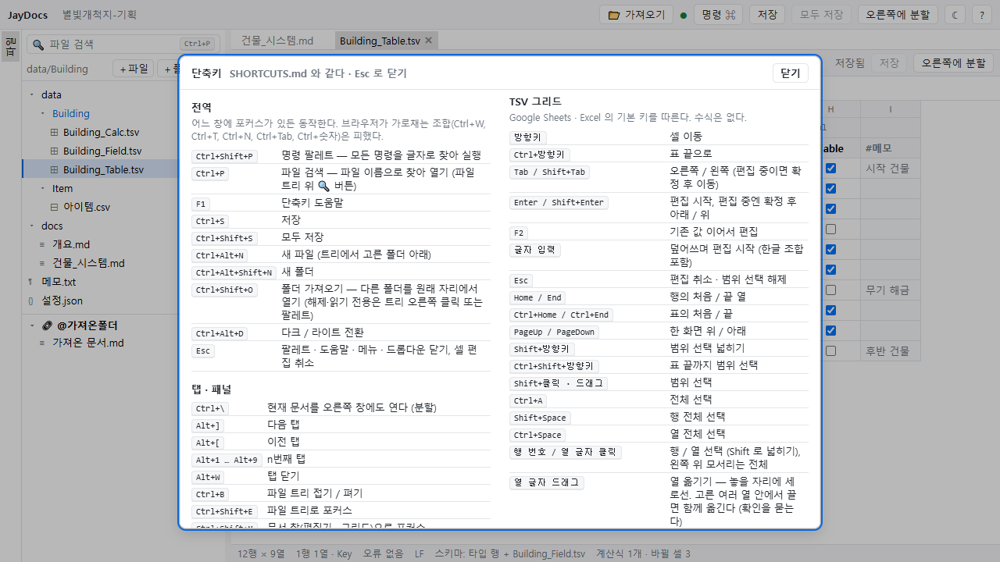
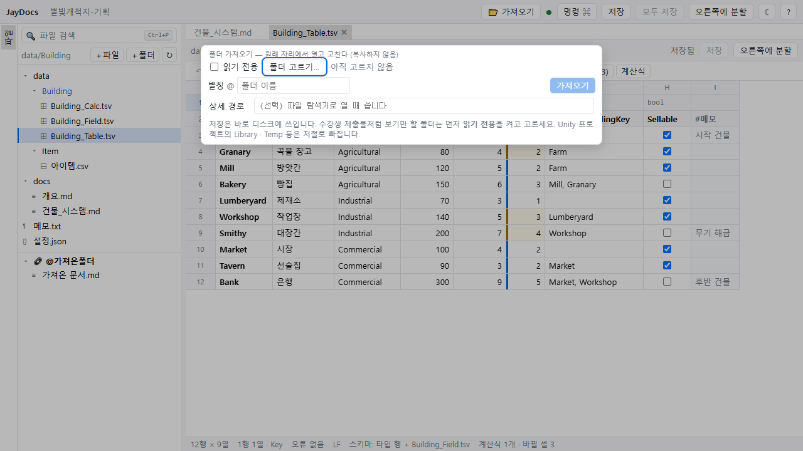
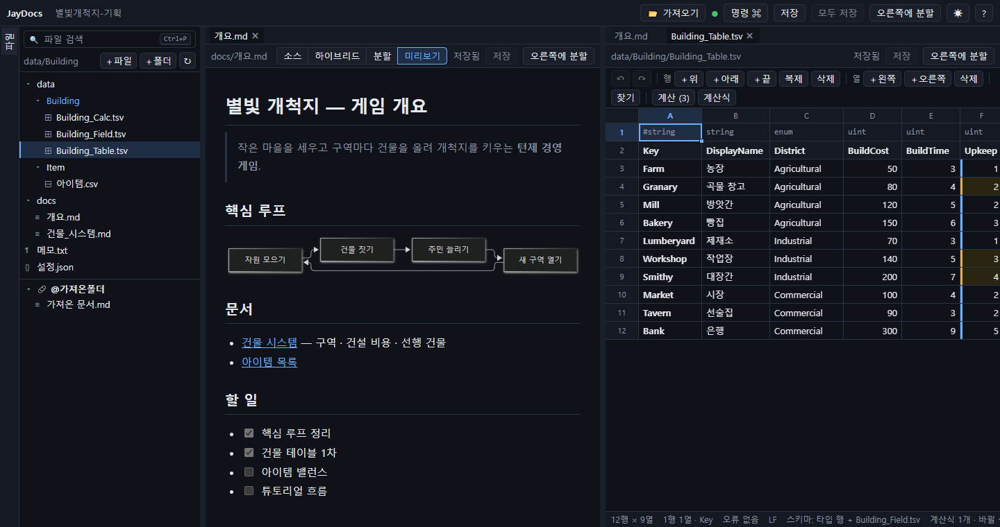

# 6. 작업 환경 — 탭 · 분할 · 폴더 · 키보드

[← 사용 가이드 목차](../../README.md#사용-가이드)

## 탭 · 화면 나누기

- **탭을 끌어서** 오른쪽(또는 아래)에 놓으면 화면이 나뉘어요.
- **오른쪽에 분할** (`Ctrl+\`) — 지금 문서를 오른쪽 창에도 열어요. 같은 문서를 두 창에 열면 **한쪽에서 고친 내용이 다른 쪽에 바로** 보여요.
- 문서는 왼쪽, 표는 오른쪽에 두고 쓰는 식이 편해요.

- 탭 이동 `Alt+]` / `Alt+[`, n번째 탭 `Alt+1~9`, 탭 닫기 `Alt+W`.
- 파일 트리 접기 `Ctrl+B`, 트리로 포커스 `Ctrl+Shift+E`, 문서 창으로 포커스 `Ctrl+Shift+M`.
- 트리에 포커스가 있으면 방향키로 다니고 `Enter` 열기, `F2` 이름 바꾸기, `Delete` 삭제, `Shift+F10` 오른쪽 클릭 메뉴.
- 탭 배치 · 열 너비 · 보기 모드는 기억해 두었다가 다음에 열 때 그대로 돌려놔요.

## 키보드로 전부 — 명령 팔레트 · 파일 검색

**`Ctrl+Shift+P` 명령 팔레트** — 모든 명령을 글자로 찾아 실행해요. 단축키가 기억 안 날 때 여기서 찾으면 돼요.

**`Ctrl+P` 파일 검색** (파일 트리 위 🔍 버튼) — 파일 이름 일부만 쳐도 찾아 열어요. 글자 순서만 맞으면 띄어쓰기 없이도 걸려요.

**`F1` 단축키 목록** — 전체 단축키를 한 화면에서 봐요. ([SHORTCUTS.md](../../SHORTCUTS.md) 와 같은 내용)

## 다른 폴더 같이 열기 (가져오기)

수업 자료, Unity 프로젝트의 문서 폴더처럼 **다른 곳에 있는 폴더를 복사하지 않고 원래 자리에서** 같이 열어요.

1. `Ctrl+Shift+O` 또는 맨 위 **📂 가져오기**.
2. **폴더 고르기…** 로 폴더를 골라요. 고르면 그 폴더에 든 문서의 수와 목록이 보여요 — 맞는 폴더가 아니면 **다른 폴더…** 로 다시 골라요.
3. **가져오기**. 별칭은 비우면 폴더 이름이 돼요.
4. 트리 맨 아래에 `🔗 @별칭` 으로 붙어요.

**폴더 선택 창에는 폴더만 보여요**(Windows 가 그렇게 띄워요). 안의 파일을 보면서 고르려면 **파일 탐색기에서 폴더를 JayDocs 창에 끌어다 놓으세요** — 가져오기 창이 그 폴더로 바로 떠요.

- **보기만 할 폴더**(예: 수강생 제출물)는 **읽기 전용** 을 켜고 가져오세요(고른 뒤에 켜도 돼요). 🔒 가 붙고 저장 · 삭제 · 이름 바꾸기가 막혀요.
- 트리의 `@별칭` 을 오른쪽 클릭하면 읽기 전용 켜기/끄기 · 새로 고침 · **가져오기 해제**(파일은 그대로)를 할 수 있어요.
- Unity 프로젝트를 통째로 가져와도 `Library` `Temp` `Logs` `obj` `Build` 같은 폴더는 저절로 빠져요. 다만 큰 프로젝트는 읽는 데 시간이 걸리니 문서 폴더만 고르는 편이 좋아요.
- 가져온 폴더의 파일 경로는 `@별칭/…` 이에요. 그 안의 md 에서 쓰는 `tsv-view` 의 `file:`, `/` 로 시작하는 링크, 계산식 `lookup` 은 **그 가져온 폴더 기준**으로 풀려요.
- 가져온 목록은 주 폴더별로 기억해 두었다가 다음에 열 때 돌아와요. 해제한 폴더는 가져오기 창의 "최근 폴더" 에서 한 번에 다시 가져와요.
- 항목이 2만 개를 넘는 폴더는 `⚠` 가 붙어요. 하위 폴더를 가져오세요.
- 주 폴더 안에 있거나 주 폴더를 감싸는 폴더, 브라우저가 막는 시스템 폴더는 가져올 수 없어요. 주 폴더 ↔ 가져온 폴더 사이로 파일을 옮길 수도 없어요.

## 바깥에서 바뀐 파일

엑셀에서 표를 고치거나 `git pull` 로 파일이 바뀌면 JayDocs 가 알아채요.

- **내가 손대지 않은 문서** → 조용히 다시 읽어요.
- **고치던 중인 문서** → 위에 배너가 떠서 **디스크 내용 받기**(내 수정 버림) / **내 내용으로 덮어쓰기** 중 골라요.

## 다크 모드

`Ctrl+Alt+D` 또는 오른쪽 위 ☾ / ☀. 처음엔 Windows 설정을 따라가요.

## 폴더 바꾸기 · 최근 폴더

- 맨 위 폴더 이름을 누르면 다른 문서 폴더로 바꿔요. 전에 연 폴더는 가져온 폴더 · 탭 배치까지 같이 돌아와요.
- 시작 화면에 최근 폴더가 10개까지 `문서 별칭 | 상세 경로` 로 보여요. ✎ 로 고치고 × 로 목록에서만 지워요(폴더와 파일은 그대로).

## 파일 탐색기에서 열기

트리에서 오른쪽 클릭 → **파일 탐색기에서 열기**. 폴더는 열고, 파일은 선택해서 보여 줘요.

- 웹 앱은 탐색기를 직접 열 수 없어서, 처음 누르면 **연결 도우미**를 한 번 설치하라는 안내가 떠요(Windows 전용).
- 설치가 싫으면 **전체 경로 복사** 를 써요. 둘 다 시작할 때 넣은 **상세 경로**가 있어야 해요.
- 도우미는 폴더를 보여 주거나 파일을 선택해 보여 주기만 하고, 파일을 실행하지 않아요. 지우려면 도우미 파일을 `/uninstall` 과 함께 실행해요.

## 업데이트

새 버전이 나오면 앱이 알아서 받아 두었다가 **모든 창을 닫고 다음에 열 때** 적용해요. 쓰는 도중에 저절로 새로고침되는 일은 없어요.

- 맨 위(시작 화면에선 아래쪽)의 **업데이트 확인** 버튼으로 바로 확인할 수 있어요. `업데이트 확인` → `새 버전 받는 중…` → `새 버전 적용` 으로 바뀌어요.
- 저장 안 한 문서가 있으면 적용이 막혀요. 먼저 저장하세요.
- 지금 버전은 시작 화면에 `버전 2026-11-01 · 25cf10b` 처럼 보여요. 버그를 알려 주실 때 같이 적어 주세요.

---

[← 5. 계산식](calc.md) · 다음: [7. 자주 묻는 질문 →](faq.md)
